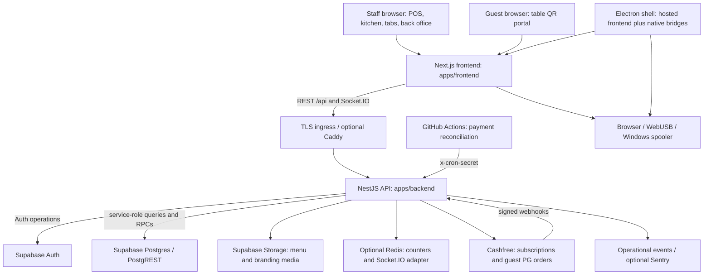
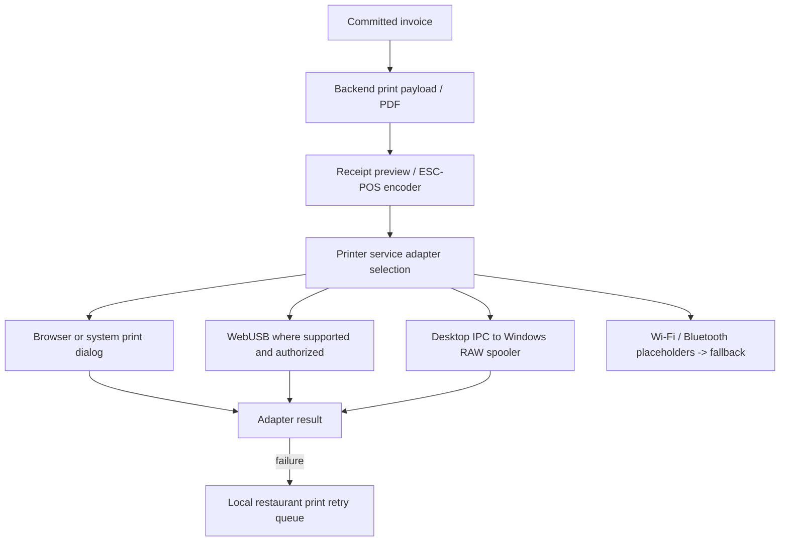
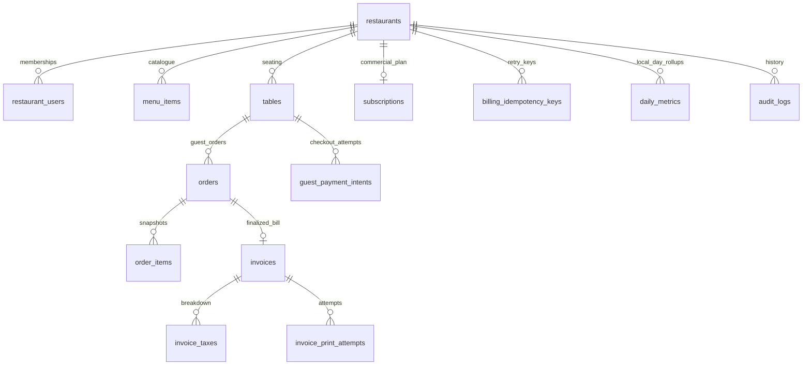

# Architecture

## Scope and evidence

This document describes the implementation in this repository, not a verified production deployment. File references are repository-relative; line anchors identify the code inspected for this revision and can move as code changes. Deployment configuration, provider account activation, applied SQL, hardware compatibility, and operational availability must be checked independently.

QR Dines is a restaurant-scoped POS, QR ordering, billing, and back-office application. Its central trust boundary is the **NestJS API using a Supabase service-role client**, not a browser-to-database RLS session. Payment collection, kitchen preparation, invoice finalization, and physical printing are separate operations with different durability guarantees.

Related operational documents: [Deployment](DEPLOYMENT.md), [Development](DEVELOPMENT.md), [Observability](OBSERVABILITY.md), and [Payments go-live](PAYMENTS_GO_LIVE.md).

## 1. Components and runtime boundaries



| Component | Responsibility | Important boundary / source |
|---|---|---|
| Next.js frontend | Public pages, authenticated workspace, POS, guest menu, kitchen and back-office screens | `apps/frontend/src/app`, `apps/frontend/src/features`; business data travels through `apps/frontend/src/lib/api/client.ts:54` |
| NestJS backend | Authentication, tenant/role/plan checks, pricing, order workflow, SQL orchestration, provider integrations | `apps/backend/src/app.module.ts:33`, `apps/backend/src/main.ts:77` |
| Supabase Auth | User accounts, sign-in, refresh, password recovery | `apps/backend/src/auth/auth.service.ts`; browser calls the backend auth API |
| Supabase Postgres | Durable tenant data, invoice transactions, constraints, audit and metrics | `apps/backend/supabase/schema.sql` plus `migrations/` and RLS/grant configuration |
| Supabase Storage | Uploaded menu images and branding; media URLs consumed by browser/receipt rendering | `apps/backend/src/menu`, `apps/backend/src/settings`, `apps/backend/src/common/image-upload.ts` |
| Redis | Shared throttling counters and optional cross-process realtime fan-out | `apps/backend/src/redis`, `apps/backend/src/realtime/realtime.gateway.ts:62`; not the authoritative order store |
| Electron desktop | Native window around the hosted web app, printing, encrypted session persistence, kiosk/autostart/update integration | `apps/desktop/src/main.js:59`; not a bundled offline backend or local replica of Postgres |
| Cashfree | Two distinct integrations: restaurant SaaS subscriptions and guest one-time payments | `apps/backend/src/billing-plans/cashfree.service.ts`, `cashfree-payments.service.ts` |
| Scheduled workflow | Requests reconciliation of open guest payment intents | `.github/workflows/payment-reconcile.yml:6`; external scheduler, not a Nest cron loop |
| Caddy/container configuration | One supported backend ingress/deployment arrangement | `compose.production.yml`, `deploy/Caddyfile`, `Dockerfile`; existence does not prove this arrangement is deployed |

The frontend requires an absolute `NEXT_PUBLIC_API_URL` whose path is `/api`; development defaults to `http://localhost:3001/api`. Socket.IO connects to that URL's **origin**, not the `/api` REST prefix (`apps/frontend/src/lib/realtime.ts:10`). An ingress must route both HTTP API calls and Socket.IO traffic. The desktop loads `config.appUrl`; it does not start Nest or Supabase locally.

## 2. Backend domain/module map

`AppModule` imports the following domain and infrastructure modules. URL examples include the global `/api` prefix. Controller decorators remain the authoritative route inventory; not every module uses the same URL ordering.

| Module / source directory under `apps/backend/src/` | Domain responsibility | Principal records / integration |
|---|---|---|
| `auth` | Register/signup/login/refresh/logout/recovery and current user | Supabase Auth; registration guard differs from public signup |
| `restaurants` | Workspace onboarding and membership-visible restaurant list | `restaurants`, `restaurant_users`, initial subscription/settings |
| `billing-plans` | Plan catalogue, effective entitlements, subscription checkout/webhook, trial reminders | `plans`, `subscriptions`, Cashfree Subscriptions |
| `menu` | Categories, menu items, availability, media, translations, option groups | `categories`, `menu_items`, `menu_item_option_groups`, `menu_item_options` |
| `tables` | Table management, opaque QR tokens, activation/pause/token rotation | `tables`; `/api/restaurants/:restaurantId/tables` |
| `ordering` | Public table context/menu, guest orders, waiter/bill requests, guest payment intents/webhook/reconcile | `/api/public/t/:token/*`, `guest_payment_intents` |
| `orders` | Staff POS order CRUD, incoming QR queue, preparation transitions, prepaid auto-finalization | `orders`, `order_items` |
| `tabs` | Group open QR orders by table and consolidate for one bill | Uses shared orders; no separate durable `tabs` table |
| `service-requests` | Staff handling of guest waiter/bill requests | `service_requests`, realtime notifications |
| `billing` | Billing rules, totals, bill-number preview and invoice finalization orchestration | `finalize_invoice_transaction`, `apply_stock_for_order` RPCs |
| `invoices` | Invoice retrieval, void/reprint operations, receipt payload/layout/PDF | `invoices`, `invoice_taxes`, `invoice_print_attempts` |
| `settings` | Tenant configuration, billing/printer settings, branding | `settings` key/value JSON; owner-only mutations through capability guards |
| `audit-logs` | Audit history and exports | Immutable `audit_logs` |
| `dashboard` | Summary, historical metrics, QR performance | `daily_metrics`, invoices, open orders, item-sales RPC |
| `team` | Login membership invitations and role changes | `restaurant_users`, `restaurant_invites` |
| `staff` | Personnel records, attendance, payroll/payout records | `staff_members`, `staff_attendance`, `staff_payouts`; payroll records are not necessarily login users |
| `expenses` | Expense categories/entries and profitability inputs | `expense_categories`, `expenses`; payroll linkage |
| `inventory` | Per-menu-item stock and movement ledger | `menu_items` stock fields, `stock_movements` |
| `outlets` | Authorized cross-restaurant aggregation | Membership/ownership over multiple restaurants, not one global tenant bypass |
| `export` | Restaurant data CSV exports | Existing domain tables, plan and capability gates |
| `realtime` | Authenticated restaurant Socket.IO room delivery | `restaurant:<id>` room; ephemeral events |
| `webhooks` | Generic and Razorpay-oriented event intake/recording | `webhook_events`; distinct from Cashfree domain settlement |
| `supabase`, `redis`, `observability`, `health` | Database clients, counters/cache, telemetry and health/readiness | Infrastructure services, not independent business domains |

`authz` supplies reusable role/capability guards; the global guard registered in `AppModule` is the throttler, not a universal authentication or tenant guard. Each protected controller/service must apply the appropriate checks.

## 3. Tenancy and the actual database trust model

### 3.1 Tenant identification

- `restaurants.id` is the tenant key. `restaurant_users` links a Supabase user to a restaurant and stores that user's **per-restaurant** role.
- Most root domain tables contain `restaurant_id`. Child records such as `order_items` and `invoice_taxes` derive tenancy through their parent, so services must first authorize the parent before querying children.
- The frontend's selected restaurant is UI state, not authorization. Changing a URL parameter or local storage must never confer access.
- `assertRestaurantAccess` queries both `user_id` and `restaurant_id` and rejects missing membership (`apps/backend/src/common/tenant.ts:4`). Services then scope root reads/writes with the restaurant ID.
- Public guest routes derive restaurant and table from the stored opaque QR token, rather than accepting an arbitrary tenant ID from the request body.

```mermaid
sequenceDiagram
  participant UI as Staff client
  participant Guard as JWT / role / entitlement guards
  participant Service as Domain service
  participant DB as Service-role Supabase client
  UI->>Guard: Bearer token + restaurant route parameter
  Guard->>Guard: Validate identity and route-specific permissions
  Guard->>DB: Resolve membership / role / subscription as needed
  Guard->>Service: User context
  Service->>DB: Assert membership; scope queries to restaurant
  DB-->>Service: Rows / transactional RPC result
  Service-->>UI: Tenant-scoped response
```

### 3.2 Service role versus RLS

`SupabaseService` creates its shared client with `SUPABASE_SERVICE_ROLE_KEY` and disables session persistence/refresh (`apps/backend/src/supabase/supabase.service.ts:11`). Domain services inspected here use `getClient()`. **Service role bypasses RLS**: a forgotten tenant predicate or authorization check in this path is not rescued by a row policy.

RLS still matters at the external Data API boundary:

| Database configuration | What it protects | What it does not establish |
|---|---|---|
| `supabase/rls.sql` | Enables RLS on core tables and creates membership policies using `(select auth.uid())` | Does not enforce application capabilities or plan entitlements; service role bypasses these policies |
| `20260827_rls_initplan_auth_uid.sql` | Recreates core membership policies with InitPlan-friendly `auth.uid()` expressions | Does not convert service-role requests into tenant JWT requests |
| `20260827_security_rls_hardening.sql` | Enables RLS on listed newer domain tables; revokes public/anon/authenticated execution on named privileged RPCs and grants service role | Does not remove existing policies, enable RLS on every possible table, or prove target database grants |
| `20260908_guest_payments.sql:46` | Enables RLS on payment intents with no added policy; newly created intents table is backend-only | Existing manually added policies would still need inspection |

Core policy-enabled tables and newer deny-by-default tables coexist. Statements such as “all tables have no policies” or “RLS is the backend tenant enforcement layer” are inaccurate. The hardening migration's historical comments are not a live security audit. Inspect `pg_policies`, table RLS flags, and function privileges on the target project, including sequence tables and any objects added after the hardening migration.

Privileged invoice RPCs are `SECURITY DEFINER`. They accept explicit actor/restaurant arguments and perform membership checks, but do not replace API identity validation or all capability checks. Restricting execution to the backend is essential because their arguments and computed totals are supplied by trusted server code.

### 3.3 Tenant token helper is not the production data path

`apps/backend/src/supabase/tenant-supabase.service.ts:93` can mint and verify HS256 tokens with `sub`, `tenant_id`, `role: 'member'`, `app_id`, `iat`, and `exp` (default five minutes). This does **not** mean tenant-scoped RLS clients are fully integrated:

- `getSession()` returns placeholder credentials when no cache entry exists.
- Redis client/session caching includes placeholder behavior.
- `refreshToken()` mints from supplied identifiers rather than validating the previous token.
- The inspected auth controllers do not expose this helper as a tenant-token login/refresh API.
- The helper's `role: 'member'` is not the restaurant capability role map or proof of a supported Supabase database-role session.

Treat it as incomplete infrastructure, not a replacement for `SupabaseService`, a revocation system, or an offline authorization guarantee.

## 4. Identity, roles, and commercial entitlements

### 4.1 Authentication

`SupabaseJwtGuard` expects `Authorization: Bearer <token>`. It first verifies using `SUPABASE_JWT_SECRET` with `jose`; if local verification fails, it tries Supabase `auth.getUser(token)` (`apps/backend/src/auth/auth.guard.ts:20`). Missing tokens/secrets and invalid identity are rejected and recorded as auth-failure signals.

`/api/auth/register` has `RegistrationGuard`; `/api/auth/signup` is a separate rate-limited self-serve endpoint without that registration guard. Do not describe the registration token as globally disabling signup. Refresh and password recovery are implemented through `AuthService`, not the tenant-client stub.

Browser sessions are persisted by Zustand in local storage. Inside Electron, the session store uses the preload `secureStore` bridge instead (`apps/frontend/src/stores/session-store.ts:13`). Neither browser storage nor the tenant selector is a server trust boundary. Realtime currently performs only local JWT verification, without the REST guard's Supabase fallback.

### 4.2 Per-restaurant capabilities

The authoritative map is `apps/backend/src/authz/role.ts:43`. `RoleGuard` reads route/class decorators and allows **any one** listed capability when multiple capabilities are supplied. With no role/capability metadata it returns true; service membership checks remain necessary (`authz/role.guard.ts:23`).

| Role | Capability set |
|---|---|
| `owner` | Floor, back office, outlets, team, settings |
| `manager` | Floor plus menu/tables/dashboard/staff/expenses/inventory/export; no owner-only settings/team/outlets |
| `staff` | POS billing, manage orders, kitchen display, manage tabs |
| `cashier` | POS billing |
| `waiter` | Manage orders and tabs |
| `kitchen` | Kitchen display |

Unknown stored role strings normalize to `staff`, not to owner and not to zero permissions. Missing membership returns null. Database query failures propagate rather than silently fabricating a role.

### 4.3 Plans are a separate axis

`billing-plans/entitlements.ts` is authoritative for runtime feature flags; database plan prices/catalogue fields are separate. A role grants permission to operate a feature; an entitlement determines whether that restaurant has the feature at all.

| Feature / limit | Starter | Dine-In QR | Pro |
|---|---|---|---|
| POS/KOT foundation | KOT enabled | KOT enabled | KOT enabled |
| QR ordering / tables | Off / 0 | On / 30 | On / 200 |
| Team / non-owner staff limit | Off / 0 | On / 3 | On / 5 |
| Realtime orders | Off | Off; polling remains | On |
| Photo menu / analytics plus | Off | Off | On |
| Payroll / expenses / inventory / multi-outlet / export | Off | Off | On |

An `active` subscription unlocks its plan. A `trialing` subscription does so only while `trial_ends_at` is valid and in the future; otherwise the effective plan is Starter. `current_period_end` is returned for display but is not itself used by `activePlanCode` to expire an `active` subscription (`entitlements.ts:110`). Missing/unknown plans fall back to Starter. Public QR token resolution returns 404 when QR ordering is unavailable.

Cashfree SaaS checkout is owner-only and maps the selected paid plan/cadence to configured gateway plan IDs. A browser return is not subscription activation; the signed subscription webhook changes status. See the payment runbook for signature and event-ordering caveats.

## 5. Request security and transport

`apps/backend/src/main.ts:77` configures Express/Nest with:

1. Global `/api` prefix; explicit body parsing with Nest's default parser disabled.
2. Request tracing, compression, and centralized exception/observability handling.
3. Separate raw-body mounts for `/api/webhooks/cashfree` and `/api/webhooks/cashfree-payment`, each capped at 1 MB, **before** JSON parsing. One mount does not cover the other because of path-segment matching.
4. JSON and URL-encoded body limits of 6 MB.
5. Helmet headers, CSP, disabled `x-powered-by`, and production HSTS. These API headers are not a substitute for frontend-specific security policy.
6. CORS from `CORS_ORIGINS`; production startup rejects an empty list or `*` (`config/environment.ts:94`).
7. `ValidationPipe` with transformation, property allowlisting, and rejection of unknown DTO fields.
8. Proxy trust controlled by integer `TRUST_PROXY_HOPS` (0–5). Set it to the real ingress topology; blindly trusting forwarded IPs undermines rate limiting.

Global throttling is 600 requests per 60,000 ms per IP, with per-route overrides. Redis-backed storage can fall back to local memory, so multi-replica limits degrade when Redis is unavailable (`app.module.ts:43`). Guest placement/payment starts are 10/minute, quotes 20/minute, waiter/bill requests 3/minute, Cashfree webhooks 120/minute, and reconciliation 10/minute. These are application limits, not gateway delivery guarantees.

Security mechanisms differ by surface:

| Surface | Authentication / scope |
|---|---|
| Staff REST | JWT plus route-specific role/entitlement checks and service tenant checks |
| Public guest REST | Possession of table QR token; restaurant/table resolution, entitlement and mutation-specific checks |
| Staff Socket.IO | JWT, membership, realtime entitlement during handshake |
| Cashfree webhooks | Timestamped raw-body HMAC; no staff JWT |
| Payment reconciliation | Timing-safe `x-cron-secret` comparison; no user JWT |
| Supabase Data API / RPCs | RLS and SQL grants, separately from the backend service-role path |

An opaque table token is a bearer capability, not proof of physical presence or an individual diner's identity. Table token rotation invalidates old links; status queries are additionally table-scoped. Neither token possession nor a guest return URL is evidence of payment.

## 6. Guest ordering and state separation

### 6.1 Context and server-authoritative pricing

`OrderingService.resolveTable` resolves `tables.qr_token`, checks QR entitlement, then reads the restaurant and owner switches (`ordering.service.ts:336`). Context returns branding, table label, ordering-open state, and gateway-credential-based `online_payment`. Menu visibility requires active/available/nondeleted items; photo URLs are stripped unless both plan and owner settings permit photos.

Context/menu responses advertise `public, max-age=30, stale-while-revalidate=60`. This permits stale display during revalidation; it is not a strict 30-second freshness guarantee. The current shared frontend request wrapper also requests `cache: 'no-store'`. Mutations re-read state and re-price the cart rather than trusting cached prices.

`order-pricing.ts:33` validates menu ownership, item availability, modifier ownership/availability, deduplicated selections, and required/min/max option groups. It snapshots names, option labels/deltas, quantities, and unit prices. Guest payloads do not dictate prices. Staff POS creation differs: authorized staff can submit order item names/prices/discounts (`orders.service.ts:331`), so the guest pricing guarantee should not be generalized to every staff order endpoint.

### 6.2 Independent state axes

| State axis | Values / use | Important distinction |
|---|---|---|
| Order business status | `open`, `billed`; tab consolidation uses `merged`; other staff status operations exist | Determines editability/billability, not whether funds were collected |
| Kitchen `prep_state` | `placed → accepted → preparing → ready → served`; cancellation from each nonterminal stage | Kitchen state is separate from business status and payment status |
| Order payment metadata | Default `unpaid`; prepaid order records `paid`, `online_payment_ref`, `paid_amount`, `paid_at` | Paid orders remain `open` until invoiced |
| Guest intent status | `pending`, `processing`, `paid`, `failed`, `expired` | An intent is not an order, invoice, or bank settlement |
| Invoice status | `finalized`, `voided` | Voiding accounting does not refund Cashfree |
| Print attempt / local print job | Requested/success/failure/retry representations | Printer success is not invoice creation or verified paper output |

```mermaid
flowchart LR
  Cart[Guest cart] --> Choice{Checkout path}
  Choice -->|Counter| Open[Open QR order + items]
  Choice -->|Online| Intent[Pending priced-cart intent]
  Intent --> Gateway[Cashfree hosted checkout]
  Gateway --> Verify[Signed webhook or reconciliation]
  Verify --> Claim[Claim pending to processing]
  Claim --> Paid[Open QR order: payment_status paid]
  Open --> Kitchen[Kitchen workflow]
  Paid --> Kitchen
  Kitchen --> Served[Served]
  Served --> Finalize[Staff finalize / prepaid best-effort auto-finalize]
  Finalize --> Invoice[Finalized invoice; order billed]
  Invoice --> Print[Receipt / PDF / print attempt]
```



Counter orders are created immediately. A sequential retry with the same `client_request_id` returns an existing restaurant-scoped order; a unique index protects duplicate keys and insert races are re-read. The open QR order cap is 15 per table, but count-then-insert is not a database-atomic reservation. The request-ID lookup is restaurant-scoped, whereas order status reads are restaurant **and table** scoped (`ordering.service.ts:381`, `:251`).

Online checkout first stores a priced intent, then creates a Cashfree PG order. No order enters the kitchen before settlement. There is no equivalent per-table intent cap. The service passes `cashfree_vendor_id` when present, but does not check vendor activation. The context flag depends only on shared credentials; see the runbook before enabling these globally.

Kitchen transitions require `orders.status = 'open'` and validate the currently read prep state. The subsequent update does not compare the prior prep state, so concurrent staff transitions are not serialized by a compare-and-set. On `served`, prepaid orders attempt an `online` invoice using `auto_online_<orderId>`; failure is swallowed so staff must detect and manually finalize remaining paid/served/open orders (`orders.service.ts:436`). Cancellation does not initiate a refund.

## 7. Billing, tabs, and concurrency boundaries

### 7.1 Calculation and finalization

`billing/billing.utils.ts:75` performs scaled-integer/paise calculations, item discounts, default 2.5% CGST plus 2.5% SGST, optional service charge on taxable subtotal, and final nearest-rupee rounding. This is a specific billing policy, not a general tax engine for every jurisdiction or GST arrangement.

`BillingService.finalizeInvoice` reads tenant-scoped order/items and current billing settings, recomputes totals, and calls `finalize_invoice_transaction` (`billing.service.ts:81`). The payment migration's RPC definition permits `cash`, `card`, `upi`, and `online`.

Inside the SQL transaction:

- Membership is checked against the supplied actor/restaurant.
- A restaurant-scoped idempotency row is inserted/locked and its request fingerprint compared.
- Order and existing invoice rows are locked; an existing invoice can be returned.
- Bill and invoice sequences are locked/incremented.
- Invoice/tax rows, `orders.status = 'billed'`, completed idempotency metadata, and audit records are committed together.
- The invoice trigger updates restaurant-local daily metrics in the same database transaction.

GST invoice numbers use the year/restaurant-code/sequence format. Separate bill labels are padded to at least three digits and use configurable never/daily/monthly/yearly reset periods. The preview does not reserve a number (`billing.service.ts:34`). The invoice year uses database `extract(year from now())`; bill reset periods use the restaurant timezone.

Finalized invoice financial fields and void metadata are protected by triggers. Reprints update permitted counters and persist attempts; void requires actor/time/reason. B2B GSTIN/address updates and stock deduction happen **after** the finalize RPC and are best-effort, not part of its atomic commit (`billing.service.ts:170`).

### 7.2 Running tabs

`tabs/tabs.service.ts:98` returns a single open order unchanged. For multiple open QR orders it creates a new open, non-kitchen order, copies selected item columns, and marks source orders `merged`. Final invoicing is a separate request.

Current limits are operationally important:

- Consolidation is a sequence of REST database writes with compensating deletion, not one locking SQL transaction.
- There is no table-checkout idempotency key or cross-cashier lock.
- The copy list omits `options_snapshot`.
- Queries do not exclude paid or cancelled-prep open orders, and the new header does not preserve prepaid payment references/amounts.

Do not use multi-order consolidation as a safe mixed prepaid/unpaid settlement mechanism without addressing these gaps. A paid order should not be collected again simply because a consolidated header defaults to unpaid.

### 7.3 Guarantees and gaps by operation

| Operation | Implemented protection | Remaining limitation |
|---|---|---|
| Guest counter submit | Unique `(restaurant_id, client_request_id)` index plus retry/race lookup | Header/items writes are separate; cap check can race; lookup is not table-scoped |
| Guest payment start | Lookup by restaurant/table/request ID, reuse stored session | No unique constraint on intent request ID; simultaneous starts can create multiple sessions; no payload fingerprint |
| Payment materialization | Conditional `pending → processing` claim | Header/items/final intent update are not one transaction; crash recovery can duplicate an already-created order |
| Payment reference uniqueness | Intent `cashfree_order_id` is unique | `orders.online_payment_ref` has no unique constraint in inspected SQL |
| Invoice finalize | SQL transaction, locks, unique restaurant/order invoice index, idempotency fingerprint | Totals/items are read before RPC lock; generic order writes do not share the same transaction |
| Invoice fingerprint | Includes actor, restaurant, order, payment method | Does not fingerprint all cart/customer/configuration fields; another actor using the same key can conflict |
| Stock deduction | RPC updates stock/movement rows | Separate best-effort call; no per-order sale uniqueness/idempotency guard, so repeated finalize calls can deduct again |
| Tab checkout | Compensating deletion on some failures | No atomic claim/merge; concurrent checkouts can copy the same orders |
| Service request dedupe | Looks up existing open request per table/kind | No corresponding unique open-request index in inspected base schema; concurrent inserts can race |
| Realtime / printing | Notifications and retry mechanisms | Neither provides exactly-once durable delivery |

The invoice RPC's guarantees must not be extended to the whole checkout, payment, stock, or print lifecycle.

## 8. Realtime, polling, and offline behavior

### 8.1 Realtime is advisory invalidation

`RealtimeGateway` verifies the handshake JWT, membership, and `realtime_orders` entitlement before joining a restaurant room (`realtime.gateway.ts:79`). It emits `realtime.ready`; clients treat that as confirmation rather than assuming a socket connection means authorization. Domain services emit `orders.changed`, `service.requested`, and `service.resolved` through `RealtimeService`.

These events are not a durable event log or queue. There are no persisted offsets or replay-on-reconnect semantics. Clients re-fetch REST state and retain polling:

| Surface | Poll behavior in source |
|---|---|
| Incoming orders | 10-second interval, `features/orders/incoming-orders-view.tsx:103` |
| Running tabs | 15-second interval, `features/tabs/tabs-view.tsx:80` |
| Guest order tracker | 8-second interval until billed/served/cancelled, `features/ordering/guest-ordering-view.tsx:154` |
| Guest checkout return | Up to 40 status reads, approximately 2.5 seconds apart, then a support reference; not provider reconciliation |

Redis fan-out is attached only if Redis is connected when `afterInit` runs. No later adapter retry is shown; verify initialization ordering and the adapter-attached log before claiming multi-replica push works. Without it, broadcasts remain process-local. Existing sockets are checked at join time, not continuously for role/plan changes or token expiry.

### 8.2 Offline means local drafts, not offline fiscal finalization

The frontend maintains local cart drafts and a pending billing queue. `lib/offline-queue.ts:94` stores the queue in local storage, filters by restaurant, retains the latest **50 actions globally**, and makes failed actions retryable after 30 seconds. That delay is eligibility, not an autonomous background scheduler.

`features/billing/billing-view.tsx:434` replays while the billing view is mounted, authenticated, restaurant-selected, and online, including on the reconnect event. It creates/reuses an order, then finalizes with the saved key. It stops a replay pass after an error. The provider outside that view tracks connectivity and queue counts; it is not a durable worker.

Limitations:

- An offline action is a draft; authoritative invoice numbers, database audit records, and final invoices are created after reconnect.
- Browser storage clearing, quota errors, device loss, or the 50-action retention limit can lose local work.
- This queue is not shared across devices and has no cross-tab transactional lock.
- If order creation succeeds but its response is lost before its ID is persisted, a retry can create another order; invoice idempotency alone does not solve that boundary.
- Guest Cashfree checkout and server payment reconciliation require network access. A saved guest cart is not a saved payment confirmation.
- No local database/backend is started by Electron. Main-frame load failures show `offline.html` and retry the hosted app after five seconds (`apps/desktop/src/main.js:48`).

## 9. Frontend state and printing

### 9.1 State ownership

| State | Owner/source | Persistence / authority |
|---|---|---|
| Identity/session | `stores/session-store.ts` | Browser local storage or desktop secure store; API validates tokens |
| Restaurant selection/list | `stores/tenant-store.ts` | Persisted UI state; membership must still be checked on server |
| Plan/role display | `stores/entitlements-store.ts`, `lib/capabilities.ts` | UI gating mirrors server concepts; never sufficient authorization |
| Cart and billing controls | `stores/billing-store.ts`, `lib/offline-cart.ts` | Local editing/drafts; server finalization remains authoritative |
| Connectivity and pending count | `stores/offline-store.ts`, `components/providers/offline-resilience-provider.tsx` | Browser/API events; does not prove backend health or durable sync |
| Menu metadata cache | `lib/menu-metadata-cache.ts` | UX fallback; stale data must not override guest server pricing |
| Guest checkout/tracking | `features/ordering/guest-ordering-view.tsx` | Checkout cart recovery and intent polling; provider/browser return is not proof of money |

### 9.2 Print pipeline



`lib/printers/printer-service.ts:26` prefers the desktop adapter whenever its bridge is available; otherwise it chooses the configured web adapter and falls back to browser printing if unavailable. Browser and `system` map to the browser adapter. Wi-Fi/Bluetooth adapters are placeholders, not verified native network transports. WebUSB depends on browser/device support and a user-granted connection.

The Electron bridge accepts ESC/POS bytes and uses PowerShell/Windows `winspool.drv` RAW printing (`apps/desktop/src/printing.js:82`). Native raw printing returns an error on non-Windows platforms. Desktop availability does not itself prove native printing works on the host OS or printer.

Failed print jobs are retained per restaurant in local storage. Jobs with fewer than five attempts are retryable (`lib/printers/print-queue.ts:9`); storage writes are best-effort. A browser dialog or successful spool submission is not proof that paper emerged. Reprinting must not finalize another invoice, and failed printing must not roll back a committed sale.

Desktop hardening includes context isolation, renderer sandboxing, disabled Node integration, single-instance locking, same-origin navigation handling, optional kiosk/autostart and updater integration. Session encryption and hosted-app trust remain distinct from local draft/print-queue storage and actual device security.

## 10. Database base schema and migration layers

`schema.sql` is a substantial base snapshot, **not a complete current-schema replacement**. In particular it lacks the guest payment intent table/payment columns, online rollup additions, and later subscription/catalogue fields supplied by migrations; its finalize allowlist still excludes `online`. Running the base schema again after migrations can replace newer function bodies and reset seeded plan prices.

| Schema layer / migration group in `apps/backend/supabase/` | Purpose |
|---|---|
| `schema.sql` | Core restaurants/memberships/menu/orders/invoices/settings/audit, many later domain structures and initial RPC definitions |
| `rls.sql` | Core membership policies and RLS enablement; separate from base SQL |
| `performance-hardening.sql` | Additional performance setup; inspect applicability rather than assuming the runner executes it |
| `20260626_billing_printing_upgrade.sql` | Expanded invoice/customer/cashier/bill numbering and transaction functions |
| `20260629_dashboard_metrics.sql` | Metrics table/trigger, full historical backfill, item/category sales RPC |
| `20260630_billing_plans.sql` | Plans/subscriptions, existing-restaurant Starter backfill |
| `20260701_qr_ordering.sql` through `20260705_menu_translations.sql` | QR tables/order fields, availability, service requests, modifiers, translations |
| `20260706_restaurant_invites.sql` through `20260709_inventory.sql` | Team invitations, payroll/attendance, expenses, stock ledger/deduction |
| `20260816_restaurant_contact.sql`, `20260819_invoice_customer_b2b.sql` | Restaurant receipt contact and buyer GSTIN/address |
| `20260827_fk_indexes.sql` | Dynamic missing single-column FK indexes; applies only to objects present when run |
| `20260827_rls_initplan_auth_uid.sql`, `20260827_security_rls_hardening.sql` | Core policy optimization, newer-table RLS and privileged function grant hardening |
| `20260830_menu_item_description.sql` | Menu description field |
| `20260903_plan_prices.sql`, `20260904_pro_price_update.sql`, `20260904_starter_free.sql`, `20260922_starter_paid.sql` | Annual price column and successive catalogue changes; Starter was free-forever briefly, then re-priced to paid (350/3000); filename order matters |
| `20260904_subscription_provider.sql`, `20260904_trial_reminder.sql` | Cashfree subscription mapping and reminder dedupe timestamp |
| `20260908_guest_payments.sql` | Order payment metadata, optional vendor reference, backend-only payment intents |
| `20260909_invoice_online_payment.sql` | Online finalize method and `pay_online` rollups/backfill |
| `20260910_payment_reconciliation.sql` | Intent expiry/default/backfill and open-intent scan index |

The migration runner (`apps/backend/scripts/migrate.mjs:69`) reads SQL files in sorted filename order, uses `schema_migrations`, and applies each pending file in its own transaction. It does not initialize the base schema. `scripts/setup-supabase-db.sh:23` applies only `schema.sql` and `rls.sql`; it does not run the migration directory.

`--baseline` records **all current migration names without executing them**. Use it only after verifying every relevant change already exists. A clean migration ledger is not sufficient evidence of correct function bodies, policies, or provider readiness. DDL/backfills can lock/rewrite data; “idempotent” does not mean safe to replay historical files arbitrarily during service.

Selected relationships:



## 11. Integration boundaries and known gaps

| Boundary | Implemented | Not established / follow-up |
|---|---|---|
| Cashfree guest PG | Create order/session, signed webhook, intent claim/materialization, scheduled open-intent reconciliation | No vendor onboarding/status gate, refund workflow, transactional exactly-once materialization, or complete late-payment recovery |
| Cashfree SaaS | Owner checkout and subscription-ID webhook mapping | Separate webhook secret requirement; cancellation is best-effort; no monotonic event-version protection or verified provider contract from unit mocks |
| Easy Split | `order_splits` with 100% to a configured vendor ID | No onboarding UI/API/status column in inspected code; missing vendor means no split; payout arrival is external evidence |
| Generic/Razorpay webhooks | Event normalization and event-record plumbing | Payment handlers use placeholder amount/payload extraction; not a guest payment/refund ledger (`webhooks/webhooks.service.ts:209`) |
| Fiscal accounting | Transactional invoice finalization, audit, void, metrics | No automatic Cashfree refund on void/cancel; paid amount is not checked against later invoice total |
| Inventory | Advisory stock and sale movement RPC | No reservation at guest payment start; no exactly-once post-finalize deduction |
| Realtime | Restaurant room broadcasts, polling fallback | No durable replay; multi-instance fan-out needs verified Redis attachment |
| Offline / desktop | Local drafts, print retries, native hosted-app shell | Not offline-first replication or guaranteed background sync |
| Operational telemetry | Request traces, operational events, optional Sentry | Optional sinks and soft failures mean absence of alerts does not prove success |

Before launch or a trust-boundary refactor, review cross-tenant tests, payment/reconciliation specs, billing RPC behavior, raw-body delivery, target SQL grants, and real provider/hardware evidence. Repository tests and configuration express intended behavior; they are not proof that production, settlement routing, or a printer is correctly configured.
