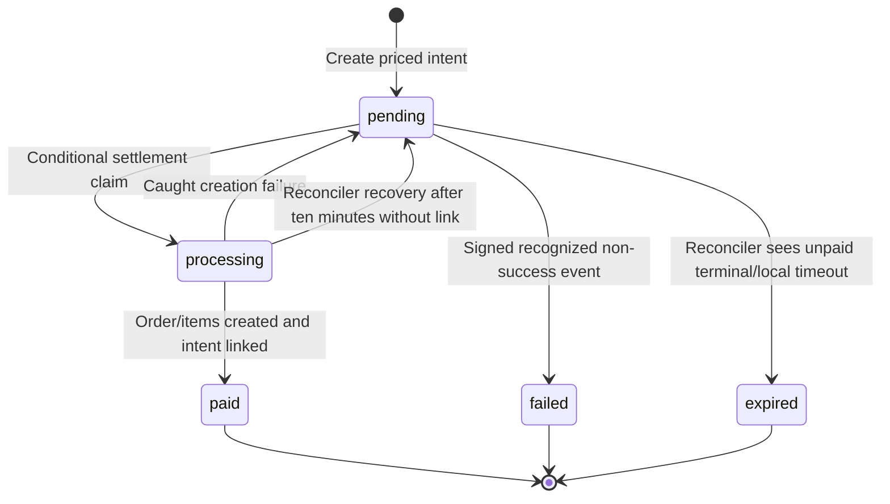

# Payments go-live runbook

## Scope, evidence, and release posture

This runbook covers **guest pay-at-table through Cashfree PG** and distinguishes it from **restaurant SaaS subscriptions through Cashfree Subscriptions**. It describes repository behavior, not verified live account activation, production database state, successful payouts, or a compliance certification.

**Do not activate broadly just by setting production credentials.** The current guest checkout has no per-restaurant payment-enable switch, no active-vendor gate, and no implemented vendor onboarding workflow. It also has material concurrency and late-payment recovery limitations documented below. Treat these as release decisions/blockers, not as features that configuration magically supplies.

Use repository-relative source references to verify behavior when this runbook or code changes. Relevant overview: [Architecture](ARCHITECTURE.md); operational context: [Deployment](DEPLOYMENT.md) and [Observability](OBSERVABILITY.md).

### Corrections to assumptions in earlier instructions

| Assumption | Verified repository behavior |
|---|---|
| “Only active Easy Split vendors can take payments” | False here. Only `cashfree_vendor_id` exists; no `cashfree_vendor_status` column/check or onboarding API/UI was found in the inspected app/SQL. |
| “The platform never receives another restaurant's settlement” | Not guaranteed. `order_splits` is omitted when no vendor ID is present; account/provider configuration determines unsplit settlement. |
| “Cashfree webhook secret is optional everywhere” | Guest PG accepts `CASHFREE_SECRET_KEY` or `CASHFREE_WEBHOOK_SECRET`; the subscription verifier requires `CASHFREE_WEBHOOK_SECRET` specifically. |
| “The return poll verifies payment against Cashfree” | It only reads the local intent. The scheduled reconciler makes the provider status query. |
| “Every successful webhook is confirmed with a provider GET” | The guest webhook settles from an authenticated success event; it does not call `getOrderStatus`. |
| “Settlement is exactly once” | A conditional intent claim reduces races, but order creation and final intent linkage are separate writes without unique order payment-reference enforcement. |
| “Unset credentials to roll back safely” | Unsafe while attempts remain unresolved: it disables provider status reconciliation and can prevent signature verification; credentials are shared with subscriptions. |
| “Every five minutes means recovery in five minutes” | The workflow is scheduled every five minutes, subject to scheduling delays, scan limits, gateway availability, and intent eligibility. |
| “A cancelled/voided bill refunds the guest” | No Cashfree refund creation or refund-ledger reconciliation is implemented. |

## 1. Two Cashfree integrations, not one payment lifecycle

| Property | Restaurant SaaS subscription | Guest meal payment |
|---|---|---|
| Server service | `apps/backend/src/billing-plans/cashfree.service.ts:33` | `apps/backend/src/billing-plans/cashfree-payments.service.ts:40` plus `ordering/guest-payment.service.ts` |
| Provider API | PG `/subscriptions` | PG `/orders` |
| API version sent | `2023-08-01` | `2023-08-01` |
| Business reference | `subscriptions.cashfree_subscription_id` | `guest_payment_intents.cashfree_order_id`, then `orders.online_payment_ref` |
| Price authority | Configured gateway dashboard plan ID selected by plan/cadence | Server-priced menu cart and shared billing calculation |
| Start route | `POST /api/restaurants/:restaurantId/subscription/checkout` | `POST /api/public/t/:token/pay` |
| Caller | Authenticated restaurant owner | Guest holding a table QR token |
| Return destination | `/settings/billing?checkout=return` | `/t/:token?pay=return&intent=:intentId` |
| Webhook route | `POST /api/webhooks/cashfree` | `POST /api/webhooks/cashfree-payment` |
| Signing key candidates | **Only** `CASHFREE_WEBHOOK_SECRET` | Dedicated webhook secret, then API secret; either matching nonempty candidate is accepted |
| Result | Subscription status/period update; no meal order | Paid order materialization; later invoice finalization |
| Cron in this runbook | Not a subscription reconciliation job | `/api/internal/payment-reconcile` scans open guest intents |

Both services report enabled when `CASHFREE_APP_ID` and `CASHFREE_SECRET_KEY` are nonempty. Both use production only when trimmed `CASHFREE_ENV` is exactly `production`; otherwise they use sandbox. These shared credentials mean changing environments affects both integrations.

Subscription checkout checks membership and owner role, resolves `CASHFREE_PLAN_<PLAN>_<CADENCE>` (all three tiers, including Starter, need a dashboard plan_id), creates a mandate, best-effort cancels a previous mandate, and updates the local mapping. Cash paid offline is recorded separately with `provider='manual'` via the operator script (`scripts/activate-cash-subscription.mjs`) — webhooks never touch those rows. The checkout method itself does not set status to active; it also does not explicitly reset the existing status to pending. Activation/status changes come through the subscription webhook (`cashfree.service.ts:207`). Verify upgrade behavior, not just new subscriptions.

Provider status mapping is `ACTIVE → active`, `CANCELLED/COMPLETED/EXPIRED → canceled`, `ON_HOLD/PAUSED → past_due`, everything else `pending`. Webhook reconciliation applies the event status and optional period end without a monotonic event-version check or provider status fetch. Best-effort cancellation can leave a prior mandate active; investigate in the provider account rather than assuming it was cancelled.

## 2. Guest payment flow and evidence chain

```mermaid
sequenceDiagram
  participant G as Guest browser
  participant A as Ordering API
  participant D as Postgres via service role
  participant C as Cashfree PG
  participant J as Reconciliation workflow
  participant S as Staff
  G->>A: POST token/pay/quote with item IDs, quantities, options
  A->>D: Resolve table, entitlement, menu and billing settings
  A-->>G: Itemized server-computed total
  G->>A: POST token/pay with client_request_id
  A->>D: Check ordering switches; insert pending priced-cart intent
  A->>C: Create PG order; optional 100% vendor split
  C-->>A: payment_session_id
  A->>D: Store session ID
  A-->>G: intent ID, session ID, mode, amount
  G->>C: Hosted SDK checkout
  C->>A: Signed success webhook with original raw body
  A->>A: Verify HMAC and timestamp
  A->>D: Conditional pending to processing claim
  A->>D: Insert open, paid QR order and snapshot items
  A->>D: Update intent to paid and link order
  C-->>G: Browser return URL
  G->>A: GET token/pay/intentId (local status only)
  opt Lost or delayed webhook, eligible open intent
    J->>A: POST internal/payment-reconcile with secret
    A->>C: GET provider order status
    C-->>A: PAID
    A->>D: Shared claim/materialization path
  end
  S->>A: Advance prep state to served
  A->>D: Best-effort invoice finalize as online
```

Here “settle intent” means **record the paid meal order locally**. It does not mean the bank payout has settled. Keep these identifiers separate during support:

| Identifier / record | Purpose |
|---|---|
| Restaurant ID / table ID | Local tenant and table scope |
| `client_request_id` | Guest attempt reuse hint; not a provider payment ID |
| Intent UUID | Guest status/support reference |
| `cashfree_order_id` | Application-generated `qrpay_...` reference used in PG create/get/webhook lookup |
| `cf_order_id` | Returned by provider; gateway wrapper exposes it, but the orchestration does not persist it in the inspected path |
| `cashfree_payment_session_id` | Browser checkout session; treat as sensitive checkout material, not public support-log content |
| `orders.id` / `online_payment_ref` | Local meal order and its provider-order link |
| Invoice ID / invoice number / bill label | Accounting evidence, created later |
| Provider payment/refund/payout references | External financial evidence; no complete local ledger for these references is implemented |

### 2.1 Endpoints and guards

All guest endpoints are under `/api/public/t/:token` and use opaque table-token scoping, not a staff JWT. `resolveTable` requires a QR-ordering entitlement (`ordering/ordering.service.ts:336`).

| Method / suffix | Operation | Important checks / effects |
|---|---|---|
| `GET /` | Context | Returns `online_payment` based on shared credential presence, not vendor activation |
| `GET /menu` | Guest catalogue | Active/available/nondeleted items, options, plan/owner photo gating |
| `POST /orders` | Counter-pay guest order | Re-prices, checks table/restaurant pause, open-order cap; remains callable even when online context is true |
| `POST /pay/quote` | Bill preview | Re-prices and calculates; does not create an intent and does not itself reject paused ordering |
| `POST /pay` | Create intent and provider order | Requires configured credentials, active/nonpaused table and restaurant, positive total; 10/minute throttle |
| `GET /pay/:intentId` | Local confirmation poll | Filters intent by ID, resolved restaurant, and resolved table; no provider GET and no local settlement attempt |
| `GET /orders/:orderId` | Prep/billing status | Filters order by restaurant and table |

Context/menu responses declare a short public cache policy (`max-age=30, stale-while-revalidate=60`); stale UI is possible and the frontend wrapper currently requests no-store. Creation checks are authoritative. A UI badge or cached flag is not an activation gate.

Server sources: `ordering/ordering.controller.ts:12`, `guest-payment.service.ts:55`, `order-pricing.ts:33`. DTOs accept item IDs, quantities/options, optional customer name/note/request ID and optional phone; the gateway uses a placeholder phone when absent. Validate the acceptability of that fallback and supported currencies with the actual account before release. The default is INR, but restaurant currency is passed through; this is not evidence every currency is enabled.

## 3. Webhook security: exact bytes and different secrets

### 3.1 Raw-body transport contract

`apps/backend/src/main.ts:77` disables Nest's default body parser and registers these mounts before general JSON parsing:

| Route | Parser |
|---|---|
| `/api/webhooks/cashfree` | `express.raw({ type: '*/*', limit: '1mb' })` |
| `/api/webhooks/cashfree-payment` | Separate identical raw mount |

The first path does **not** match the second at an Express path-segment boundary. Preserve both. Controllers convert the Buffer to UTF-8 text and pass it to the verifier. Their object/JSON-stringify fallback is not a guarantee of byte-equivalent verification; a healthy delivery must reach the intended raw route without middleware or ingress reformatting JSON.

Both integrations read `x-webhook-signature` and `x-webhook-timestamp`, compute:

```text
base64(HMAC-SHA256(signing_secret, timestamp + original_raw_body))
```

and compare same-length signature buffers with `timingSafeEqual`. Timestamp freshness allows Unix seconds or milliseconds and an absolute five-minute window, including clock skew. Synchronize server clocks and inspect delayed provider retries; freshness enforcement can reject an old but otherwise valid signature.

### 3.2 Secret selection is not uniform

- Guest PG: `cashfree-payments.service.ts:152` accepts any matching nonempty unique candidate from `CASHFREE_WEBHOOK_SECRET` and `CASHFREE_SECRET_KEY`.
- Subscriptions: `cashfree.service.ts:145` reads **only** `CASHFREE_WEBHOOK_SECRET`. Missing that variable makes subscription verification fail even if PG payments work.
- Configure each variable with the signing material actually used by that provider event stream. A variable name alone does not configure a separate secret at Cashfree. If the provider signs subscription events with the API secret for your account/version, the current subscription verifier still requires that value to be present in `CASHFREE_WEBHOOK_SECRET`.
- Do not publish keys, signature-bearing payloads, phone/email/cart contents, or checkout sessions in public logs/issues. Use secure provider tooling for evidence.

### 3.3 What a verified event does

Guest parser recognizes nested `data.order.order_id` and `data.payment.payment_status`, with flat data fallbacks. Success is inferred from `PAYMENT_SUCCESS_WEBHOOK` **or** `payment_status = SUCCESS` (`cashfree-payments.service.ts:183`). The webhook handler verifies signature/freshness, then:

| Event outcome | Current behavior |
|---|---|
| Missing/unrecognized order ID | Acknowledges `{ received: true }`; no order |
| Recognized order ID but not success | Marks a still-pending intent `failed`, regardless of whether the event is a final order failure |
| Success with pending intent | Calls shared `settleIntent` |
| Already processing/paid/failed/expired or unknown ID | Claim finds nothing; acknowledged without materializing an order |
| Materialization throws | Handler returns an error (`BadRequestException`) so provider retry is possible |
| Invalid signature or stale timestamp | 401 and `payment.webhook.verify_failed` signal |

A 200 is therefore an acknowledgement, **not proof of a created order**. The guest webhook does not fetch Cashfree's order status or compare event amount/currency with the stored total. Reconciliation fetches provider status but also does not compare its returned amount with the intent. These are current validation gaps; do not describe the path as amount-verified end to end.

Only configure payment event types whose handling has been verified with this code. Do not add refund or unrelated events to the guest route expecting supported processing: a recognized order ID with a non-success event can fail a pending intent. The generic `webhooks` module and its Razorpay-oriented refund event recording do not implement Cashfree refunds.

## 4. Easy Split: what exists and what must be supplied operationally

`20260908_guest_payments.sql:21` adds nullable `restaurants.cashfree_vendor_id`. `GuestPaymentService.createPayment` reads only that field. `CashfreePaymentsService.createOrder` adds:

```json
{
  "order_splits": [
    { "vendor_id": "<verified-restaurant-vendor-id>", "percentage": 100 }
  ]
}
```

when the field is nonempty (`cashfree-payments.service.ts:96`). Without it, the create request has **no split instruction**. There is no source-level guarantee that funds avoid the platform account. A 100% split instruction also does not prove payout timing, fees, deductions, or bank receipt.

### Missing application capabilities

- No vendor creation/KYC onboarding endpoint or settings page implementation was found.
- No `cashfree_vendor_status` column/migration or active-status read exists in the inspected code.
- No vendor-status synchronization webhook/polling job exists in this payment flow.
- No per-restaurant payment enable/disable setting gates `createPayment`.
- Missing vendor lookup data is treated as no vendor; lookup errors are not surfaced as a fail-closed onboarding check.

### Operational onboarding prerequisites

Before allowing a restaurant to start live sessions:

1. Confirm platform/account KYC and PG/Easy Split product approval with Cashfree. Do not rely on a fixed approval-time promise.
2. Complete that restaurant's vendor onboarding through the provider's supported process and obtain evidence of its actual approved/active state.
3. Verify the vendor belongs to the intended production account and that its bank/beneficiary identity matches the restaurant. Sandbox IDs are not production evidence.
4. Have an authorized operator record the exact mapping through a controlled database/change process; the app does not provide the workflow described in older documentation.
5. Verify a created provider order contains the expected split and later verify payout at the restaurant account.
6. Keep ordering closed for all unapproved restaurants, or block live payment creation until a properly reviewed per-tenant activation gate exists. Shared credentials otherwise expose online checkout to every eligible open QR restaurant.

An application-enforced active-vendor/payment-enable gate is recommended before broad rollout. Manual onboarding verification is a temporary operational control, not an implemented fail-closed guarantee or a legal conclusion.

## 5. Database preparation: base schema is insufficient

Do not apply only the three newest payment migrations to an unknown database. Confirm its base objects, previously applied migrations, function definitions, RLS flags, grants, and backups first. The following files were inspected for the payment/billing dependencies; paths below are relative to `apps/backend/supabase/`.

| File | Payment relevance / verification |
|---|---|
| `schema.sql` | Base orders/items/invoices, tax/rounding fields, idempotency keys, audit/print tables, sequences, settings, metrics, plans, tables and RPCs. It is not a fully current payment schema. |
| `rls.sql` | Core RLS/policies; backend service role bypasses them. Check separate Data API exposure. |
| `migrations/20260626_billing_printing_upgrade.sql` | Invoice customer/cashier/bill fields, `bill_sequences`, immutability function, expanded 11-argument finalize RPC and related functions. |
| `migrations/20260629_dashboard_metrics.sql` | Daily metrics and trigger plus historical recomputation; replay deletes/rebuilds metrics and reinstalls the pre-online function. |
| `migrations/20260630_billing_plans.sql` | Plans/subscriptions and existing-restaurant Starter seed; needed for QR entitlement resolution. |
| `migrations/20260701_qr_ordering.sql` | Tables/token linkage and QR order fields; unique restaurant/request-ID index for **orders**, not payment intents. |
| `migrations/20260704_menu_options.sql` | Option group/option tables and `order_items.options_snapshot`, consumed by shared guest pricing. |
| `migrations/20260709_inventory.sql` | Post-finalize stock RPC/ledger; separate from invoice transaction, without per-order retry dedupe. |
| `migrations/20260816_restaurant_contact.sql` | Restaurant phone/email/address used in receipts and subscription customer details. |
| `migrations/20260819_invoice_customer_b2b.sql` | Buyer GSTIN/address columns; best-effort post-finalize update in backend. |
| `migrations/20260827_fk_indexes.sql` | Missing-FK indexes for objects present at execution time; does not automatically cover later payment tables. |
| `migrations/20260827_rls_initplan_auth_uid.sql` | Core membership-policy refresh. |
| `migrations/20260827_security_rls_hardening.sql` | Newer-table RLS, named privileged RPC execute restrictions and trigger search-path hardening. Verify actual grants after all changes. |
| `migrations/20260903_plan_prices.sql` | Adds annual catalogue price and sets earlier prices. |
| `migrations/20260904_pro_price_update.sql` | Pro catalogue becomes INR 1,299 monthly / 12,000 annually. |
| `migrations/20260904_starter_free.sql` | Starter becomes zero monthly / null annual. Dine-In QR remains 999 / 10,000 from preceding price file. |
| `migrations/20260904_subscription_provider.sql` | `subscriptions.provider`, `cashfree_subscription_id`, lookup index; not a unique subscription-ID constraint. |
| `migrations/20260904_trial_reminder.sql` | Reminder dedupe timestamp; not a guest payment reconciler. |
| `migrations/20260908_guest_payments.sql` | Order payment metadata, optional vendor ID, guest intents with unique `cashfree_order_id`, RLS enabled with no added policy. |
| `migrations/20260909_invoice_online_payment.sql` | Replaces finalize RPC to permit `online`; adds `daily_metrics.pay_online`, replaces rollup function, backfills existing metric rows. |
| `migrations/20260910_payment_reconciliation.sql` | Adds/backfills `expires_at` to creation plus 15 minutes, sets insert default, adds open-intent `updated_at` index. |

Other menu/domain migrations in the repository remain part of a complete application deployment; the table above is not an alternate migration order or permission to omit earlier pending files.

### Migration procedure and hazards

1. Identify the target project and use an approved `DATABASE_URL` without exposing it in logs/history. Take and verify a backup according to the deployment procedure.
2. For a fresh project, initialize the base schema and policies first. `scripts/setup-supabase-db.sh:23` only runs `schema.sql` and `rls.sql`.
3. Inspect pending migrations with `npm --prefix apps/backend run migrate:status`.
4. Review pending SQL and historical ledger discrepancies. `npm --prefix apps/backend run migrate` applies filename-sorted pending files, each in a transaction, and records names in `public.schema_migrations` (`apps/backend/scripts/migrate.mjs:115`).
5. If using the SQL editor or a provider-supported pooler connection, maintain accurate migration tracking through the established change process. Connection/DNS/IPv4 constraints depend on the operator environment; do not assume a particular Supabase hostname universally fails.
6. Never use `migrate:baseline` to hide unapplied changes: it marks **every current file** applied without executing it.
7. Inspect final function bodies and privileges, not just migration success. Ensure no obsolete finalize overload creates PostgREST ambiguity and the intended function accepts `online`.

Do not re-run `schema.sql` or older billing/metrics migrations after the online migration as a routine deployment step: they can restore an allowlist without `online`, replace rollup functions, or reset catalogue data. Repeatable syntax does not make historical replay side-effect-free.

### Required database evidence before activation

- [ ] `orders` has `payment_status`, `online_payment_ref`, `paid_amount`, `paid_at`.
- [ ] `restaurants.cashfree_vendor_id` exists and pilot mapping is verified externally.
- [ ] `guest_payment_intents` exists with cart, amount, currency, provider reference, session, status, order linkage, timestamps and expiry default.
- [ ] RLS is enabled on intents and unexpected Data API policies/grants are absent.
- [ ] Finalize RPC supports `online`, retains idempotency/order/sequence locking, and is callable only through the intended trusted backend role.
- [ ] `daily_metrics.pay_online` exists and the active trigger function increments/reverses it on finalize/void.
- [ ] Migration ledger agrees with actual schema. Subscription mapping/price migrations are present if SaaS checkout is enabled.
- [ ] Operators understand there is **no unique payment-intent `client_request_id` constraint** and no unique `orders.online_payment_ref` constraint in the inspected payment SQL.

## 6. Environment and ingress checklist

| Variable / configuration | Requirement | Scope / caution |
|---|---|---|
| `SUPABASE_URL` | Correct project URL | Required backend startup; use the intended environment |
| `SUPABASE_SERVICE_ROLE_KEY` | Correct server-only key | Required startup; never expose through `NEXT_PUBLIC_*` or desktop renderer config |
| `SUPABASE_JWT_SECRET` | Correct verification key | Required startup/auth; staff billing access depends on it |
| `NODE_ENV` | `production` for live deployment | Enables production CORS/HSTS rules |
| `CORS_ORIGINS` | Exact allowed frontend origins | Required/non-wildcard in production; not a provider webhook auth mechanism |
| `TRUST_PROXY_HOPS` | Actual ingress hop count | Correct client-IP throttling; do not assume a topology |
| `CASHFREE_ENV` | Exactly `production` for live | Any other trimmed value selects sandbox in both integrations |
| `CASHFREE_APP_ID` | Live account App ID | With secret, globally enables guest/subscription gateway clients |
| `CASHFREE_SECRET_KEY` | Matching live API secret | API calls and one guest webhook verification candidate |
| `CASHFREE_WEBHOOK_SECRET` | Signing material matching configured provider events | Required by subscription verifier; optional additional guest candidate |
| `APP_BASE_URL` | Intended public frontend origin/base URL | Builds subscription and guest returns; explicit configuration avoids hard-coded default assumptions |
| `CRON_SECRET` | High-entropy shared secret, stored securely | Required to activate internal cron route; same value in workflow secret |
| `CASHFREE_PLAN_DINE_IN_QR_MONTHLY` / `_ANNUAL` | Correct provider plan IDs | Subscription only; provider prices must match intended catalogue |
| `CASHFREE_PLAN_PRO_MONTHLY` / `_ANNUAL` | Correct provider plan IDs | Subscription only; no guest payment-plan IDs required |
| `NEXT_PUBLIC_API_URL` | Absolute backend URL ending `/api` | Frontend build configuration; not a gateway credential |
| GitHub variable `API_BASE_URL` | Backend origin, **without `/api`** | Workflow appends `/api/internal/payment-reconcile` |
| GitHub secret `CRON_SECRET` | Same as backend | Missing value causes workflow to skip successfully, not prove reconciliation ran |
| Telemetry configuration | Approved observability/Sentry configuration | Useful for diagnosis; not a substitute for financial ledger checks |

Gateway credentials are not included in the backend's three mandatory startup keys (`config/environment.ts:18`). A booting application or green generic health response does not prove payment configuration/migrations are correct.

Verify ingress permits both webhook POST paths without login redirects or JSON transformations, preserves signature/timestamp headers, and routes requests to the intended environment. Configure provider checkout-domain authorization/allowlisting according to the actual account requirements. The frontend dynamically loads the Cashfree v3 SDK and uses `_self` redirect checkout (`apps/frontend/src/lib/cashfree.ts:16`); validate frontend CSP, browser networking, and the return URL in a real sandbox session.

Default domains embedded in source/workflows are defaults, not verified live endpoints. Use the actual configured deployment values rather than copying an old hosted-service URL blindly.

## 7. Reconciliation lifecycle and schedule

### 7.1 Invocation

`POST /api/internal/payment-reconcile` accepts `x-cron-secret`; it does not use a staff JWT. Missing backend secret returns 503, wrong/missing request secret returns 403, and a successful run returns HTTP 200 with:

```json
{ "scanned": 0, "settled": 0, "expired": 0 }
```

Zeroes can mean no eligible work, gateway disabled, or a soft-failed database query. Inspect logs and schema rather than treating this response as proof of payment readiness (`payment-reconciliation.service.ts:55`).

`.github/workflows/payment-reconcile.yml` has `workflow_dispatch` and schedule `*/5 * * * *`. GitHub scheduling can be delayed. It calls the backend with the repository secret, prints the result, and expects 200. The workflow defaults to a source-configured hosted origin unless `vars.API_BASE_URL` overrides it. It is not a worker that runs inside the API process.

### 7.2 Actual scan algorithm

`apps/backend/src/ordering/payment-reconciliation.service.ts:55`:

1. No-op if gateway credentials are absent.
2. Select up to **100** `pending`/`processing` intents with `updated_at` older than **two minutes**, oldest first.
3. For a `processing` row without `order_id`, leave it alone until **ten minutes** old; then conditionally reset to pending.
4. Fetch provider order status. Provider errors/null leave the row unchanged for a later pass.
5. If status is `PAID`, call the shared settlement path before considering expiry.
6. Otherwise expire pending rows on provider `EXPIRED`, `CANCELLED`, `TERMINATED`, or `FAILED`, or when local expiry is reached. Missing explicit expiry falls back to creation plus **15 minutes**.
7. Continue best-effort after individual errors and return aggregate counts. Reconciler-created orders emit `payment.reconciled`.



### 7.3 Recovery limitations requiring an operator

- Failed and expired intents are **not scanned** and cannot be claimed by `settleIntent`. A later successful attempt on the same provider order can therefore require manual investigation.
- The local 15-minute expiry is not sent as provider `order_expiry_time` in `createOrder`. Do not assume local expiry cancels a still-payable provider session.
- A processing reset cannot know whether an order was already inserted before a crash because the intent link is written last. Search existing orders by payment reference before any manual recovery.
- Pending status reuse excludes only `failed`; a sequential start with an expired existing session can return that expired session. New user attempts must be verified rather than assumed clean.
- A start-request race can insert multiple intents for one client request ID. Session reuse has no cart fingerprint.
- A provider create request can succeed while its response is lost; the catch path deletes the local intent. That ambiguous provider outcome is not recovered by the open-intent scanner.
- Some database writes in creation/settlement are awaited without checking returned errors. A successful handler response is not sufficient evidence that every write committed.
- With a 100-row scan and no per-row timeout/backoff fields, backlog or persistently failing old rows can delay newer work. No payment-specific fetch timeout is set in these gateway calls.
- No complete provider transaction import exists for payments absent from the local intent table.

Do not promise “exactly once” or a fixed reconciliation recovery SLA from the current implementation. For unrestricted live rollout, resolve/accept these gaps explicitly with engineering and operations ownership.

## 8. Invoicing, staff workflow, and refunds

A confirmed online payment creates an order with `status = open`, `source = qr`, `prep_state = placed`, and `payment_status = paid`. It does not create an invoice immediately (`guest-payment.service.ts:297`). This allows kitchen progression while the funds are recorded.

On `served`, `OrdersService` best-effort finalizes prepaid orders using payment method `online` and deterministic key `auto_online_<orderId>` (`orders.service.ts:436`). If that fails, prep-state update still succeeds and staff must finalize manually. Confirm both the order and the invoice, not just the “Paid online” label.

Invoice totals are recomputed from order items and **current** billing settings at finalize time. Shared `calculateTotals` uses default CGST/SGST, optional service charge, and nearest-rupee rounding, but the intent stores a priced cart plus total—not a complete frozen billing-settings snapshot. The finalize path does not compare invoice total with `paid_amount`, and general open-order edits are not blocked by paid status. Freeze pilot settings and avoid editing paid carts until these invariants are enforced.

Other operational restrictions:

| Situation | Safe interpretation / action |
|---|---|
| Paid order still open after served | Check auto-finalize failure/migrations; finalize once as online, not a second collection |
| Multiple open QR orders on one table | Current tab merge does not preserve payment metadata or option snapshots; do not consolidate mixed prepaid/unpaid orders as though all are due |
| Cancelled kitchen order | Preparation cancelled only; no Cashfree refund is initiated |
| Voided invoice | Accounting/metrics reversal only; no money movement is initiated |
| Retried finalization | Invoice RPC is idempotent, but stock deduction is a separate call without per-order dedupe; inspect inventory effects |
| Provider says refunded | External financial evidence; no implemented Cashfree refund-status handler updates a local refund ledger |

### Refund limits and support procedure

There is no implemented Cashfree refund creation endpoint, partial-refund allocation, cumulative refund-limit check, split-vendor reversal workflow, or refund reconciliation job in this guest flow. Do not enable `REFUND_STATUS_WEBHOOK` expecting it to perform those functions.

For an approved refund, use the provider's supported operational tools, verify captured amount and prior refunds, and apply the provider/account's actual limits and eligibility. Record payment/order/invoice references and refund outcome in the approved support/accounting process. Decide invoice void/credit/accounting treatment separately with the responsible finance owner. Do not invent a local refunded status, silently delete a paid order, or mark a refund complete solely because an invoice was voided.

The generic `webhooks/webhooks.service.ts:243` handler mentioning `payment.refunded` uses placeholder amount/payload extraction; it is not a working Cashfree refund integration.

## 9. Sandbox activation and verification matrix

These are procedures for the release owner to execute; this documentation revision does not claim they have passed. Unit specs with mocks do not prove provider API field names, account products, checkout compatibility, or payout routing. Existing relevant specs include `cashfree-payments.service.spec.ts`, `cashfree.service.spec.ts`, `guest-payment.service.spec.ts`, and `payment-reconciliation.service.spec.ts`.

### Before taking any test payment

- [ ] Use an isolated sandbox/staging database and matching sandbox keys; prevent accidental mixing with live intents/subscriptions.
- [ ] Verify all database prerequisites, especially `online` finalize support and intent expiry/RLS.
- [ ] Create a test restaurant with valid QR entitlement, active table, available items/options, and known billing settings.
- [ ] Verify the vendor mapping/split contract in sandbox where supported; missing vendor must not be treated as a launch-ready restaurant.
- [ ] Configure the two webhook paths and appropriate signing secrets separately.
- [ ] Set the workflow target and cron secret; manually dispatch and confirm the job actually invoked the API rather than skipped.
- [ ] Use currently documented provider sandbox test instruments. Previously circulated VPAs, OTPs, and claims that shared-sandbox cards always fail are not verified by repository code and should not be treated as permanent instructions.

### Required tests and evidence

| Scenario | Expected evidence / release question |
|---|---|
| Quote only | Correct item/options/subtotal/tax/service-charge/rounding; no new intent/order |
| Paid happy path | Provider session created, authentic webhook, one linked paid order, staff queue, return tracker, later online invoice and metric bucket |
| Pause before checkout start | Server rejects new `POST pay`; cached UI cannot bypass mutation checks |
| Missing vendor | Demonstrate current unsplit behavior only in sandbox; fail release review if expecting an enforced active-vendor requirement |
| Invalid/stale signature | 401, no order change, verification-failure telemetry |
| Raw-body delivery | Real provider delivery succeeds through final ingress without JSON reserialization |
| Duplicate success delivery | One order in normal repeated-delivery case; capture intent/reference/order evidence |
| Simultaneous starts | Check for multiple intents/sessions; current schema does not guarantee one session |
| Concurrent webhook and cron | Conditional claim behavior; inspect order/reference count, not only response status |
| Guest closes browser | Webhook/cron must work independently of return polling |
| Delayed/lost webhook | Provider `PAID` on eligible open intent leads to `payment.reconciled`; record actual latency |
| Processing crash recovery | Verify no duplicate meal order after reset; current nontransactional window remains a release caveat |
| Failed attempt then later success | Verify terminal-local-state gap and define operator recovery; do not assume later success self-heals |
| Local expiry while provider session remains active | Verify provider session lifetime; define prevention/recovery before launch |
| Provider request timeout after create | Check provider for orphaned session/order when local intent is missing |
| Served auto-finalize failure | Staff can find paid/served/open order and finalize once as online |
| Billing settings change after payment | Compare actual captured amount, `paid_amount`, invoice total; current code does not enforce equality |
| Tab checkout with paid orders | Verify restriction/procedure; current merge is not payment-aware |
| Refund/cancellation | Confirm no automatic refund claim; rehearse external controlled process |
| Subscription checkout | Independently verify plan/cadence/amount, signature key, status mapping, and prior-mandate cancellation |

Prefer a controlled delayed-webhook drill in sandbox. Do not disable a shared live webhook across all restaurants for a reconciliation demonstration.

## 10. Controlled live pilot

Proceed only after the unresolved code limitations are explicitly addressed or accepted for a tightly controlled pilot, with an accountable operator and support path.

1. Record the exact release revision, target database/migration evidence, backend/frontend environment identities, and provider account/environment. Store secrets only in approved secret stores.
2. Complete platform/vendor activation and bank verification outside the application. Record the pilot restaurant's mapping and intended routing.
3. Keep **all nonpilot QR ordering closed** before enabling shared live credentials. This is necessary because the current online flag is global to configured credentials, not per restaurant.
4. Confirm raw webhook paths and clocks; separately verify subscription webhook configuration if subscriptions are in scope.
5. Confirm reconciliation scheduling and manual invocation on the intended backend. Establish a monitor for skipped/failed/delayed workflow runs and backlog age.
6. Open one pilot table. Check guest context, quote, provider create order, split instructions, and return URL.
7. Have an authorized tester make a small legitimate live payment. Never use sandbox instruments with live credentials.
8. Correlate provider paid status, local intent, exactly one meal order/reference, stored paid amount, queue visibility, served state, finalized online invoice, and daily metrics. Check for discrepancies before repeating.
9. Verify actual vendor payout/settlement evidence with the provider and restaurant bank. A paid PG order or an `order_splits` request is not enough.
10. Rehearse pause/drain handling without losing reconciliation, then document the outcome and decide whether to reopen or stop.

A successful single payment does not resolve concurrency, partial-write, refund, subscription event-ordering, or unsupported hardware concerns. Do not remove the release restrictions solely because the happy path works once.

## 11. Safe kill switch and rollback: stop creation, preserve recovery

### 11.1 Current supported pause control

Use the existing restaurant-wide QR ordering pause, not credential removal:

- Owner settings route: `PUT /api/settings/restaurants/:restaurantId/qr_ordering` with body `{ "value": { "paused": true } }`. Preserve any other existing value fields when changing the setting.
- Alternatively, table management can set `ordering_paused: true` on each intended table with `PATCH /api/restaurants/:restaurantId/tables/:tableId`.
- These are ordering pauses, **not payment-only toggles**: they also stop new counter-pay QR order placement. Staff POS collection can continue under the venue's controlled process.

Sources: `settings/settings.controller.ts:70`, `settings/dto/upsert-setting.dto.ts:3`, `tables/tables.controller.ts:33`, `ordering/ordering.service.ts:367`, `guest-payment.service.ts:72`.

Creation checks pause state before reusing a session. Quotes and status reads can remain available, and webhook/cron settlement does not consult the ordering pause. Already issued Cashfree sessions may still be paid. Pausing must therefore be followed by a **drain**, not an assumption that no more money can arrive.

For a global emergency, pause each affected restaurant/table through the controlled operational path. There is no existing `CASHFREE_PAYMENTS_ENABLED` environment switch or application-wide payment-only feature flag in the inspected code. If ingress blocks are used as a temporary additional measure, block new payment starts only and explicitly preserve both webhook routes, status reads, and internal reconciliation.

### 11.2 Drain and preserve evidence

1. Record pause time and affected restaurants. Confirm new guest payment starts are rejected server-side.
2. Keep API/signing credentials, payment tables, provider mappings, the webhook routes, and reconciliation running.
3. Inventory all attempts since the last confirmed good period, including `failed`/`expired` rows and provider orders absent from local intents—not only the cron's open set.
4. Compare provider paid/cancelled/refunded state with local intent/order/invoice references. Resolve duplicate-reference and missing-order cases through an approved repair plan; do not blindly reset all processing/terminal rows.
5. Keep enough compatible backend code and database schema to finish outstanding attempts. Do not downgrade the online finalize RPC or drop payment columns while work remains.
6. Verify pending provider sessions are drained, expired/cancelled according to provider behavior, or otherwise accounted for. Retain records for support/accounting.
7. Only then decide whether gateway configuration can be retired. Assess subscription mandates separately because the same credentials serve them.

Removing `CASHFREE_APP_ID`/`CASHFREE_SECRET_KEY` makes `enabled` false and the reconciler return zeroes. Removing signing material may also reject pending webhook deliveries. It is not the normal rollback procedure. If credentials are compromised, use an incident-specific rotation/recovery plan with provider coordination rather than preserving a compromised key or silently disabling settlement recovery.

Do not rotate/delete table tokens merely to pause ordering: it can break guests' old return/status URLs. Do not remove a vendor mapping as a kill switch: that does not disable checkout and can cause future requests to omit the split.

## 12. Monitoring and operational triage

| Symptom / signal | Check first | Do not assume |
|---|---|---|
| `payment.webhook.verify_failed` | Correct endpoint/event stream, raw bytes, matching secret, timestamp/clock and ingress | Every 401 is malicious, or guest/subscription secrets behave identically |
| Guest stuck confirming | Intent status/link, provider order, webhook result, cron eligibility/backlog | Browser redirect or bank debit automatically created an order |
| Webhook 200 but no order | Unknown/terminal/processing intent, event classification, ignored database errors | 200 proves successful materialization |
| Reconcile `{0,0,0}` | Credentials enabled, schema query warning, age/status filters, workflow actually called endpoint | No unresolved paid attempts exist |
| Growing `payment.reconciled` count | Webhook delivery/latency/rejection and provider retry behavior | Safety-net activity is equivalent to a healthy primary path |
| Paid/served/open orders | Auto-finalize failure, missing online migration, current order/settings | Staff should collect again |
| Invoice amount differs from payment | Item edits, settings changes, rounding, mixed tab merge | Shared calculator freezes all inputs |
| Incorrect/missing payout | Vendor mapping, created split, provider activation/account reports | Local paid intent proves vendor bank settlement |
| Subscription stays inactive | Dedicated subscription signing secret, plan mapping, webhook status | Guest payment success validates subscription integration |
| Multiple meal orders for one reference | Processing recovery/partial-write window and start races | Conditional claim provides system-wide exactly-once semantics |

Useful evidence sources:

- `guest_payment_intents` lifecycle and associated `orders`/`invoices` rows.
- `operational_events` entries `payment.webhook.verify_failed` and `payment.reconciled`; these optional/best-effort writes are not a complete payment journal.
- Application logs for provider create/get errors, failed materialization, reconciliation query failures, and stock/B2B update warnings.
- GitHub workflow timestamps/result bodies and provider delivery/payment/split/payout records.
- `audit_logs` order placement and invoice finalization history. Generic `webhook_events` recording is a separate path; Cashfree guest settlement does not establish a complete event ledger there.

When a guest may have been charged, ask them not to pay again until provider/local evidence is reconciled. Escalate missing orders, amount differences, duplicate references, or refunds through a controlled process with restaurant, engineering, and finance ownership. Never repair by deleting financial evidence or equating a local status label with a bank transaction.

## 13. Final release sign-off

- [ ] Code revision, target environment, schema/grants, and migration ledger verified.
- [ ] Guest PG and subscription integrations configured/tested separately.
- [ ] Vendor approval, mapping, split request, and actual payout verified; no claimed built-in active-status gate.
- [ ] Concurrent start/materialization, late payment, local expiry, and ambiguous provider-create limitations addressed or explicitly accepted with restrictions.
- [ ] Invoice/payment total invariants, prepaid tab restrictions, auto-finalize fallback, and stock retry caveats understood.
- [ ] Reconciliation runs are observed, with backlog/delay alerting and manual recovery ownership.
- [ ] Pause/drain rollback preserves credentials and pending-attempt recovery.
- [ ] Refund procedure is documented as external/manual; no unsupported automatic-refund promise.
- [ ] Pilot evidence and unresolved caveats reviewed before broader activation.
