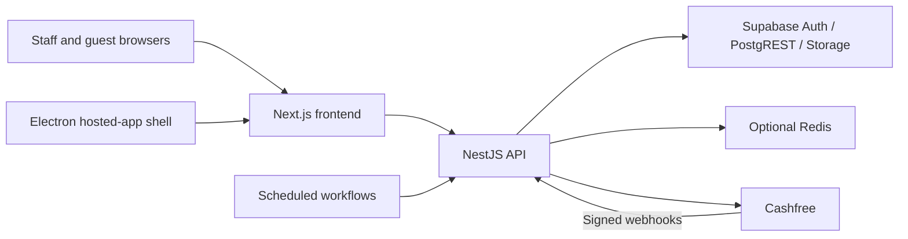

# QR Dines — Restaurant POS and QR Ordering

QR Dines is a multi-tenant restaurant application for staff billing, guest QR ordering, kitchen workflows, invoices, and back-office operations. Each restaurant has its own memberships, menu, orders, settings, and audit history. This repository contains the implementation and deployment tooling; production readiness, payment activation, and physical printer compatibility require independent verification.

## Contents

- [Applications and stack](#applications-and-stack)
- [Feature overview](#feature-overview)
- [Local setup](#local-setup)
- [Command reference](#command-reference)
- [Architecture and security boundaries](#architecture-and-security-boundaries)
- [Deployment and operations](#deployment-and-operations)
- [Documentation index](#documentation-index)
- [Contributing and security](#contributing-and-security)

## Applications and stack

| Location | Purpose | Main technologies |
| --- | --- | --- |
| `apps/backend` | REST API, authorization, domain services, integrations, SQL and migrations | NestJS 11, TypeScript, Supabase Auth/Postgres/Storage, Jest |
| `apps/frontend` | Staff workspace and public guest ordering application | Next.js 16 App Router, React 19, Tailwind CSS, Zustand, Playwright |
| `apps/desktop` | Windows-oriented shell around the hosted frontend, native printing and session storage | Electron, electron-builder, Windows RAW spooler |
| `scripts` | Initial database setup, demo provisioning, backups and restores | Bash, Node.js, PostgreSQL client tools |
| `docs` | Development, architecture, operational runbooks and feature specifications | Markdown |
| `.github/workflows` | Web application checks, container/desktop releases, smoke and scheduled jobs | GitHub Actions |
| `loadtest` | Staging load-test scenarios and instructions | k6 |

The root npm workspaces include the backend, frontend, and a `shared/*` glob. The desktop is a **separate package**, with its own installation and lockfile. Root installation and `build:all` do not install or build Electron.

## Feature overview

| Area | Implemented surface | Important qualification |
| --- | --- | --- |
| Restaurant workspaces | Signup/onboarding, restaurant selection, memberships and role-aware navigation | Backend authorization, not the selected browser tenant, controls access |
| POS and invoicing | Itemized billing, discounts, tax/service-charge calculations, invoice numbering, receipt/PDF output, audit and reprints | Finalization and printing are separate operations |
| Guest QR ordering | Table tokens, menu/options, cart, order tracking, waiter and bill requests | Requires QR entitlement and enabled table/restaurant settings |
| Kitchen and tabs | Incoming orders, preparation states, table-order consolidation | Polling remains important; review consolidation limitations before mixing prepaid and unpaid orders |
| Team | Invitations, membership roles, optional email delivery | Login memberships and payroll staff records are distinct |
| Back office | Dashboard, inventory, expenses, staff/payroll, exports and outlet views | Role capabilities and plan entitlements both apply |
| Payments | Cashfree subscription checkout and guest payment intents, webhooks and reconciliation | Separate integrations; live vendor gating, refunds and recovery gaps are documented in the payment runbook |
| Printing | Browser dialog, supported WebUSB devices, native Windows ESC/POS bridge | An installed printer is not necessarily ESC/POS-compatible; hardware validation is required |
| Resilience | Local drafts, pending billing actions, print retries, optional Redis and Sentry | Not a fully offline POS or guaranteed background synchronization system |

Read [Architecture](docs/ARCHITECTURE.md) for the actual guarantees and known limitations rather than treating a feature name as a deployment or reliability claim.

## Local setup

### 1. Prepare the tools and development project

Use **Node.js 22**, matching application CI, and a compatible npm version (npm 10+ recommended). The manifests do not enforce a Node `engines` range or pin npm. Full-stack development also needs a dedicated Supabase project with Auth enabled.

Install `psql` for schema/migration operations; `pg_dump` and `pg_restore` are optional until you need backups. Redis, Sentry, email and payment credentials are optional for ordinary local work, but required to exercise their integrations.

Run from the repository root:

```bash
node --version
npm --version
npm ci
```

### 2. Configure backend and frontend separately

Copy these examples only if the destination files do not already exist:

```bash
cp apps/backend/.env.example .env
cp apps/frontend/.env.example apps/frontend/.env.local
```

Set the following backend values from the **same development Supabase project**:

| Variable | Purpose |
| --- | --- |
| `SUPABASE_URL` | Supabase HTTP project endpoint |
| `SUPABASE_SERVICE_ROLE_KEY` | Private server credential for Auth/data operations |
| `SUPABASE_JWT_SECRET` | Required backend JWT verification configuration |
| `CORS_ORIGINS` | Allowed frontend origins; use an explicit local origin where possible |
| `DATABASE_URL` | PostgreSQL connection string for administrative scripts, not routine API queries |

Set the frontend API base in `apps/frontend/.env.local`:

```dotenv
NEXT_PUBLIC_API_URL=http://localhost:3001/api
```

The shared frontend API client requires an absolute HTTP(S) URL whose normalized path is exactly `/api`, without a query or fragment. `NEXT_PUBLIC_*` values are browser-visible and compiled into production browser bundles: never put service-role keys, JWT secrets, database passwords, or provider secrets there.

**Environment loading differs between tools:** the backend searches upward for the nearest `.env`; the migration runner falls back only to `apps/backend/.env`; setup and seeding use the root file; backup/restore require exported variables. Securely export `DATABASE_URL` for database commands if using the root configuration. Do not blindly source dotenv files as shell scripts. See the [environment-resolution reference](docs/DEVELOPMENT.md#environment-resolution-and-validation).

### 3. Prepare the database

For a genuinely empty, disposable Supabase development project, review the SQL and run:

```bash
npm run db:setup
npm --workspace apps/backend run migrate:status
npm --workspace apps/backend run migrate
```

`db:setup` applies only `schema.sql` and `rls.sql`. It does **not** apply the migration directory, create Auth users, configure Storage, or verify the complete application. The migration runner assumes base tables exist and applies pending SQL files in filename order, one transaction per file.

For an existing project, inspect and apply pending migrations rather than routinely replaying the base schema: the base file can overwrite newer function definitions and seeded plan values. `migrate:baseline` records every current filename **without executing SQL**; use it only after independently verifying all those changes already exist. It is not a fresh-project setup shortcut.

See [database setup versus migrations](docs/DEVELOPMENT.md#database-setup-versus-migrations) before administering a shared environment.

### 4. Start the applications

In separate terminals:

```bash
npm run dev:backend
```

```bash
npm run dev:frontend
```

| Service | Local address |
| --- | --- |
| Frontend | `http://localhost:3000` |
| API | `http://localhost:3001/api` |
| Liveness | `http://localhost:3001/api/health` |
| Readiness | `http://localhost:3001/api/health/ready` |

A successful liveness response does not establish database/schema readiness. Inspect readiness and startup diagnostics before testing onboarding and billing.

Use signup/onboarding to obtain an account and restaurant membership. An Auth user alone does not provide workspace access. Public `/api/auth/signup` is separate from guarded `/api/auth/register`.

### 5. Optional demo data

Explicitly configure `DEMO_OWNER_EMAIL` and `DEMO_OWNER_PASSWORD`; optionally set `DEMO_RESTAURANT_CODE` (default `DEMO`), then run:

```bash
npm run seed:demo
```

Use only disposable development accounts: the script can reset the password of an existing user, overwrite demo restaurant settings, and **prints the supplied password on success**. Do not share or retain its complete output. Its production guard checks `NODE_ENV`, not the identity of the target database; verify the target yourself. Seeding uses Supabase HTTP credentials and does not require `DATABASE_URL`.

## Command reference

All commands below run from the root unless stated otherwise.

| Command | Scope |
| --- | --- |
| `npm run dev` / `npm run dev:backend` | Backend watcher only |
| `npm run dev:frontend` | Frontend development server |
| `npm run lint` | Backend ESLint |
| `npm run lint:frontend` | Frontend ESLint |
| `npx tsc --noEmit -p apps/frontend` | Frontend TypeScript check used by CI |
| `npx tsc --noEmit -p apps/backend` | Direct backend project typecheck, including source tests |
| `npm test` | Backend Jest suite |
| `npm --workspace apps/frontend run test:unit` | Frontend Jest unit/render tests |
| `npm --workspace apps/frontend run test:e2e` | Playwright browser tests; requires production build and Chromium |
| `npm run build` / `npm run build:backend` | Backend only |
| `npm run build:frontend` | Frontend production build |
| `npm run build:all` | Backend followed by frontend, not desktop |
| `npm run audit` | Production dependency audit at high severity threshold |
| `npm run check` | Backend lint, tests and build, then dependency audit |
| `npm --workspace apps/backend run smoke -- http://localhost:3001` | Explicitly targeted live API smoke checks |

**`npm run check` is not an all-workspace gate.** Run frontend checks separately. There is no named `typecheck` script. Stop the frontend dev server before building because both write `.next`.

Playwright starts a production frontend on port 3100 and uses mocked browser API responses. It does not verify live Supabase authorization, payment settlement or printer output. Browser installation, build configuration, test selection and live smoke prerequisites are explained in [Development](docs/DEVELOPMENT.md#testing-linting-and-typechecking).

Database utilities:

```bash
npm run backup:db
```

```bash
BACKUP_FILE=backups/qr-dines-YYYYMMDDTHHMMSSZ.dump npm run restore:db
```

Both require an intentionally exported `DATABASE_URL` and PostgreSQL client tools. Restore is destructive (`--clean --if-exists`) and has no confirmation prompt. Validate recovery against a scratch project before considering production use.

## Architecture and security boundaries



- **Tenancy:** staff requests use bearer authentication, route-specific roles/entitlements and tenant-scoped service queries. The main backend database client uses the service role, which bypasses RLS; backend authorization is essential. SQL policies and grants protect separate direct Data API/RPC boundaries.
- **Routes:** Nest business routes use `/api`. Controller route shapes vary; do not assume all domains share one `/restaurants/:restaurantId/...` layout. Public guest routes begin `/api/public/t/:token`.
- **Ordering and billing:** kitchen preparation, payment status, invoice status and print results are separate state axes. A checkout return is not proof of payment; a failed print does not undo a finalized invoice.
- **Realtime:** authenticated restaurant Socket.IO rooms provide advisory updates. Guests poll order status; clients must recover authoritative state through REST. Multi-instance fan-out needs verified Redis adapter attachment.
- **Offline and desktop:** local drafts/queues help with interruptions, but require reconnection to create authoritative invoices. The desktop loads the hosted app, not a local backend/database.

Detailed domain maps, state diagrams, SQL transaction boundaries, capability tables and integration gaps are in [Architecture](docs/ARCHITECTURE.md).

## Deployment and operations

The root `Dockerfile`, `compose.production.yml`, `deploy/Caddyfile`, and `.env.production.example` support a **backend** container behind Caddy. They do not deploy the frontend, desktop, Supabase, Redis, or external alerting as a complete stack.

Before a release:

1. Review target-specific secrets, CORS/proxy settings, backup capability and release evidence.
2. Apply necessary backward-compatible migrations before code that depends on them.
3. Deploy the intended backend image and frontend build using the [Deployment runbook](docs/DEPLOYMENT.md).
4. Verify readiness, authentication, tenant isolation and representative restaurant workflows.
5. Verify payment/provider behavior separately before collecting live money; repository configuration is not proof of vendor activation or settlement routing.
6. Retain a known-good app artifact and a tested recovery plan. Rolling back an image does not roll back database changes or payments.

Sentry and Redis are optional integrations, not automatically provisioned services. GitHub workflow definitions document automation, not proof of passing checks or delivered alerts. Use [Observability](docs/OBSERVABILITY.md) and [Launch readiness](docs/LAUNCH_READINESS.md) to collect actual operational evidence.

## Documentation index

| Guide | Read it for |
| --- | --- |
| [Development](docs/DEVELOPMENT.md) | Toolchain, environment precedence, SQL setup, migrations, seeding, test commands and troubleshooting |
| [Architecture](docs/ARCHITECTURE.md) | Domain map, trust boundaries, roles/plans, ordering/payment/invoice states, concurrency and offline limitations |
| [Frontend](apps/frontend/README.md) | Routes, feature organization, stores, API conventions, CSP, tests and printing |
| [Desktop](apps/desktop/README.md) | Standalone Electron package, runtime switches, installer and native print setup; verify historical roadmap claims against current source |
| [Deployment](docs/DEPLOYMENT.md) | Target configuration, migration discipline, Compose/image operations, rollback and backups |
| [Observability](docs/OBSERVABILITY.md) | Readiness checks, instrumentation, operational events, monitoring targets and alert gaps |
| [Launch readiness](docs/LAUNCH_READINESS.md) | Release evidence, acceptance checks, incident response and restore drills |
| [Payments go-live](docs/PAYMENTS_GO_LIVE.md) | Cashfree integration boundaries, activation checks, reconciliation and live-payment blockers |
| [Load testing](loadtest/README.md) | k6 scenarios and staging-only performance verification |
| [Roadmap](docs/ROADMAP.md) | Historical implementation planning; status claims require revalidation against source and deployment evidence |
| [Aggregator roadmap](docs/ROADMAP_AGGREGATORS.md) | Proposed external-order integrations, not a guarantee of implemented connectors |
| [Dine-in specification](docs/specs/dine-in-qr-ordering.md) | Product/design requirements for QR ordering |
| [Team specification](docs/specs/team-and-roles.md) | Team and role requirements; runtime capability mapping remains authoritative |
| [Pro specification](docs/specs/qr-dine-pro.md) | Pro feature design and acceptance expectations |

Product specifications, historical audits, roadmaps, and older material under `markdown_files/` provide context; they are not substitutes for current source or operational validation. Prefer the maintained guides linked above for setup and release procedures.

## Contributing and security

Read [CONTRIBUTING.md](CONTRIBUTING.md) for the development/review workflow and [CODE_OF_CONDUCT.md](CODE_OF_CONDUCT.md) for community expectations. Report vulnerabilities through [SECURITY.md](SECURITY.md), not a public issue containing credentials, tokens, customer records, or database dumps.
